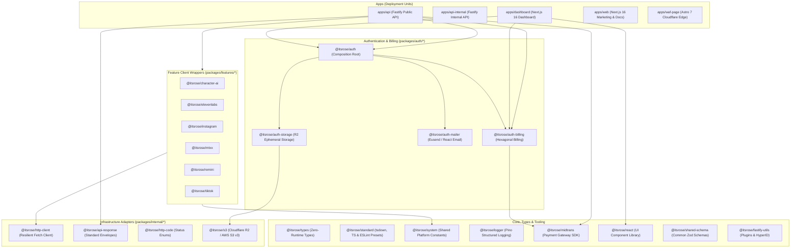

# AGENTS.md — Master Directives & Architectural Guardrails

> **Authoritative Specification for AI Coding Assistants & Autonomous Agents**
> **Repository**: `itsrose` Monorepo
> **Scope Prefix**: `@itsrose/*`
> **Package Manager**: `pnpm@11.20.0` (with isolated node linker & workspace dependency sync)
> **Task Orchestrator**: `Turbo@^2.11.7`
> **Runtime Target**: Node.js `>=24` (ESM native)
> **Last Updated**: November 2026

---

## 1. Operating Model & Core Directive

You are operating inside the **ItsRose** monorepo as an AI pair programmer and software engineer. You must maintain strict engineering discipline, protect architectural boundaries, preserve existing conventions, and never introduce speculative dependencies, incorrect export manipulations, or camelCase API payloads.

Every directive in this document is **mandatory**. If a user request contradicts an architectural invariant (e.g., asking to import a database driver into domain code or camelCase an API response), you must enforce the correct pattern defined here.

---

## 2. Monorepo Topology & Workspace Map

The workspace strictly uses the **`@itsrose`** namespace (`@itsrose/*`) for all internal packages. Applications residing in `apps/*` are deployment targets and do not use package scope prefixes.



### 2.1. Applications (`apps/*`)
| Directory           | Name           | Framework             | Responsibility                                                                                                                       |
| :------------------ | :------------- | :-------------------- | :----------------------------------------------------------------------------------------------------------------------------------- |
| `apps/api`          | `api`          | Fastify 5 (ESM)       | High-throughput public REST & WebSocket API. Implements OpenAPI/Scalar, rate-limiting, Better Auth plugin, and upstream AI features. |
| `apps/api-internal` | `api-internal` | Fastify 5 (ESM)       | Internal operational API service with ngrok tunnel integration for background and administrative workflows.                          |
| `apps/dashboard`    | `dashboard`    | Next.js 16 (React 19) | Customer and administrative web dashboard. Built using HeroUI, TanStack Query/Table, and Better Auth client.                         |
| `apps/waf-page`     | `waf-page`     | Astro 7               | Cloudflare edge challenge, bot-fight, and WAF landing pages.                                                                         |
| `apps/web`          | `web`          | Next.js 16 (React 19) | Public marketing, landing, and MDX-powered documentation site.                                                                       |

### 2.2. Modularized Authentication & Billing (`packages/auth/*`)
All authentication packages modularize Better Auth into decoupled, self-contained subdomains:
- `packages/auth/core` (`@itsrose/auth`): Server composition root, Better Auth client initialization, and plugin aggregation (`api-key`, `passkey`, `infra`, `billing`, `mailer`, `storage`).
- `packages/auth/billing` (`@itsrose/auth-billing`): SaaS subscription, proration, invoice lifecycle, Midtrans webhook verification, and recurring settlement cron tasks.
- `packages/auth/mailer` (`@itsrose/auth-mailer`): Eusend transactional email delivery service and React Email verification templates.
- `packages/auth/storage` (`@itsrose/auth-storage`): Cloudflare R2 / S3 storage plugin for user avatars and ephemeral asset uploads.

### 2.3. Feature Integrations (`packages/features/*`)
Feature packages provide isolated, typed client wrappers around upstream AI and media services:
- `packages/features/character-ai` (`@itsrose/character-ai`): Typed WebSocket & HTTP client for Character.ai.
- `packages/features/elevenlabs` (`@itsrose/elevenlabs`): Voice synthesis and audio generation client with Zod validation.
- `packages/features/instagram` (`@itsrose/instagram`): Scrapers and media extraction clients.
- `packages/features/mtxx` (`@itsrose/mtxx`): Meitu/MTXX AI image processing, inpainting, and clothes segmentation client.
- `packages/features/remini` (`@itsrose/remini`): Remini image enhancement and super-resolution client with WebSocket protocol.
- `packages/features/tiktok` (`@itsrose/tiktok`): TikWM media fetcher with strict schema validation.

### 2.4. Infrastructure Adapters (`packages/internal/*`)
- `packages/internal/api-response` (`@itsrose/api-response`): Standardized JSON response envelopes (`ApiResponse`, `ApiErrorResponse`).
- `packages/internal/http-client` (`@itsrose/http-client`): Resilient HTTP client wrapper over native fetch/undici with retry policies and exponential backoff.
- `packages/internal/http-code` (`@itsrose/http-code`): Standard HTTP status codes and business-logic semantic enums.
- `packages/internal/s3` (`@itsrose/s3`): Cloudflare R2 / AWS S3 client using AWS SDK v3 with presigned URL creation and magic-byte MIME detection.

### 2.5. Global Types & Standard Tooling
- `packages/types` (`@itsrose/types`): Pure zero-runtime TypeScript utility types (`Prettify<T>`, `DeepPartial<T>`, `ValueOf<T>`, `Nullable<T>`, `Brand<T, B>`, etc.).
- `packages/standard` (`@itsrose/standard`): Shared tooling configs (`@itsrose/standard/tsdown`, `@itsrose/standard/typescript/*`, `@itsrose/standard/eslint/*`).

---

## 3. Strict Architectural Guardrails

### 3.1. Strict Hexagonal Architecture (Ports & Adapters)
Subsystems (most notably `@itsrose/auth-billing` and service layers in `apps/api`) MUST strictly conform to Hexagonal boundaries:

```
[ Transport: Routes / Fastify / Plugins ]
                 │
                 ▼
[ Application / Domain Services (Pure Business Logic) ]
                 │
      [ Ports: TypeScript Interfaces ]
                 │
                 ▼
[ Adapters: DB / S3 / Midtrans / Redis / I/O ]
```

#### Layer 1: `domain/*` — Pure Business Logic & Orchestration
1. **Zero External SDK Imports**: `domain/*` must **NEVER** import third-party SDKs, database drivers, or network clients. No `@aws-sdk/*`, no `better-auth`, no `pg`, no `ioredis`, no `@itsrose/midtrans`.
2. **Ports Only**: All interactions with persistence, external payment processors, file storage, or time must be modeled as abstract interfaces in `domain/ports.ts` (e.g., `PlanRepository`, `SubscriptionRepository`, `PaymentGatewayPort`, `ClockPort`).
3. **Deterministic Clock**: Never call `new Date()` or `Date.now()` directly in domain workflows where timing affects subscription periods, proration, or billing grace periods. Inject `ClockPort` (e.g. `systemClock`).
4. **Domain Errors**: Domain services must throw typed domain errors (e.g., `BillingDomainError` with semantic status codes), never transport-specific errors (no HTTP status codes, no Fastify reply objects, no Better Auth `APIError`).

#### Layer 2: `adapter/*` — Raw I/O & External Provider Integrations
1. **Implement Domain Ports**: Every adapter must implement a corresponding port defined in `domain/ports.ts`.
2. **Encapsulate Third-Party SDKs**: All external vendor libraries (AWS SDK, Midtrans SDK, Redis, PostgreSQL drivers) live solely in this layer.
3. **Data Mapping**: Adapters must map external vendor payloads into clean domain entities (`ApiPlan`, `Subscription`, `TransactionInvoice`) before returning them to domain services.
4. **Webhook Security & Idempotency**: Signature verification (e.g., Midtrans HMAC SHA-512) and idempotency key handling must be resolved inside the adapter.

#### Layer 3: `plugin/*` and `routes/*` — Thin Transport Controllers
1. **Thin Footprint**: Route handlers must remain thin controllers (under 30-50 lines) restricted to:
   - Defining endpoint path, HTTP method, and middleware (auth session, rate limit).
   - Validating incoming payloads with Zod (`body`, `querystring`, `params`).
   - Extracting authenticated user context (`session.user`, `api_key`).
   - Calling application/domain services.
   - Transforming service outputs into HTTP envelopes (`@itsrose/api-response`) or mapping domain errors to HTTP statuses.
2. **Prohibited in Routes**:
   - ❌ NO raw SQL or database queries.
   - ❌ NO direct third-party SDK calls (e.g., calling Midtrans or S3 directly inside a Fastify route).
   - ❌ NO domain business logic or calculation math (e.g., proration logic).

---

### 3.2. Client/Server Bundle Isolation

The monorepo enforces absolute separation between server-side code (Node.js runtime) and client-side code (browser/React runtime).

1. **Subpath Export Architecture**:
   Multi-target packages must declare clean subpaths in `package.json`:
   ```json
   {
     "exports": {
       ".": "./src/index.ts",
       "./client": "./src/client/index.ts",
       "./react": "./src/react/index.ts",
       "./server": "./src/server/index.ts",
       "./schema": "./src/schema/index.ts",
       "./types": "./src/types.ts",
       "./package.json": "./package.json"
     }
   }
   ```
   - `.` / `./types` / `./schema`: Zero Node.js runtime dependencies. Safe for universal consumption.
   - `./server`: Node.js server composition roots, database drivers (`pg`), Redis (`ioredis`), AWS SDK (`@aws-sdk/client-s3`), secret keys.
   - `./client` / `./react`: Pure React components, hooks, formatting helpers, and Better Auth client plugins.

2. **Frontend Consumption Boundaries**:
   - Frontend applications (`apps/dashboard`, `apps/web`) must **NEVER** import from:
     - `@itsrose/auth/server`
     - `@itsrose/auth-billing/server` or `@itsrose/auth-billing/plugin-server`
     - `@itsrose/s3`
     - Direct Node.js modules (`node:fs`, `node:crypto`, `pg`)
   - Frontends may only consume `@itsrose/auth/react`, `@itsrose/auth-billing/client`, `@itsrose/react`, and root types.

---

## 4. Monorepo Build Tooling (`tsdown`) & Export Mechanics

### 4.1. Configuration Presets (`@itsrose/standard/tsdown`)
All internal packages build with `tsdown` (Rolldown/esbuild under the hood) via presets exported by `@itsrose/standard/tsdown`:
- `config` / `baseConfig`: Standard library preset (ES2024 target, CJS/ESM dual output, `.d.ts` generation, `deps.neverBundle: true`, macro preprocessors).
- `reactConfig`: React 19 component library preset with Babel React Compiler plugin.
- `fastifyConfig`: Node.js API application preset (`unbundle: true`, ESM-only, `exports: false`).
- `mergeConfig(base, overrides)`: Preserves nested preset options while applying package-specific configurations.

### 4.2. The `devExports` Mechanism
Inside `packages/standard/tsdown/config.mjs`:
```javascript
const IS_PRODUCTION = process.env.NODE_ENV === "production";
const IS_BUILD =
  process.env.BUILDING === "true" ||
  process.env.NEXT_PHASE === "phase-production-build";

export const baseConfig = {
  // ...
  exports: {
    enabled: true,
    devExports: !(IS_PRODUCTION || IS_BUILD),
    legacy: true,
  },
};
```

#### How Development vs. Production Exports Work:
1. **Development Phase (`devExports: true`)**:
   - `tsdown` inspects entries in `tsdown.config.ts` and writes `package.json` `"exports"` directly pointing to TypeScript source files:
     ```json
     "exports": {
       ".": "./src/index.ts",
       "./server": "./src/server/index.ts"
     }
     ```
   - Simultaneously, `tsdown` populates `"publishConfig.exports"` pointing to `./dist/*`:
     ```json
     "publishConfig": {
       "exports": {
         ".": "./dist/index.mjs",
         "./server": "./dist/server/index.mjs"
       }
     }
     ```
   - **Advantage**: Under `moduleResolution: "NodeNext"` or `"Bundler"`, dependent packages and Next.js/Fastify apps instantly resolve raw TypeScript source. This provides immediate cross-package Jump-to-Definition and hot-reloading with zero compilation lag.

2. **Production / Build Phase (`devExports: false`)**:
   - During `pnpm build` (`NODE_ENV=production` or `BUILDING=true`), `tsdown` compiles bundles into `dist/` and sets `"exports"` to point to the production output (`./dist/index.mjs`).

---

### 4.3. CRITICAL RULE: NEVER Manually Edit `package.json` `exports`

> [!CAUTION]
> **STRICT BAN ON MANUAL EXPORT EDITS**:
> An AI assistant must **NEVER** manually modify `"exports"` or `"publishConfig.exports"` in `package.json` to point to `./src/*` or `./dist/*` in an attempt to fix a local typecheck or module resolution error.

#### Why This Breaks the Monorepo:
- `tsdown` is the sole source of truth for export maps. Manual edits will be immediately overwritten or corrupted during subsequent builds.
- Hardcoding `./src/*` into `package.json` breaks production Docker images where source code is stripped.
- Hardcoding `./dist/*` breaks local TypeScript typechecking when packages are unbuilt.

#### Proper Procedure to Add an Export:
1. Open the package's `tsdown.config.ts`.
2. Add the file to the `entry` array or object:
   ```typescript
   export default defineConfig({
     ...config,
     entry: ["src/index.ts", "src/new-entry.ts"],
   });
   ```
3. Run `pnpm --filter <pkg-name> build` (or `tsdown`) to allow `tsdown` to regenerate `exports` and `publishConfig.exports` deterministically.

---

### 4.4. Workspace Injection (`injectWorkspacePackages: true`) & Docker Deployments

In `pnpm-workspace.yaml`:
```yaml
nodeLinker: isolated
injectWorkspacePackages: true
syncInjectedDepsAfterScripts:
  - build
```

#### Why Injected Packages Are Utilized:
- **Docker Isolated Builds**: Dockerfiles (`apps/api/Dockerfile`) use `turbo prune <app> --docker` followed by `pnpm deploy --filter=<app> --prod /prod/app`.
- If workspace dependencies were standard symbolic links, `/prod/app` would contain broken symlinks pointing outside the deployment root, causing fatal `Cannot find module` errors in the runner container.
- With `injectWorkspacePackages: true`, pnpm copies/hard-links workspace dependencies as self-contained standalone packages into target `node_modules`.
- **The `"files": ["dist", "src"]` Invariant**: When injecting packages, pnpm respects `"files"`. Every workspace `package.json` must declare `"files": ["dist", "src"]` so both development source references and production distribution bundles are available when injected.

---

## 5. Coding Conventions & Best Practices

### 5.1. CRITICAL: Mandatory `snake_case` in API Responses & Schemas

> [!IMPORTANT]
> **MANDATORY CONVENTION**: All API response payloads, request/response Zod schemas, database column mappings, and response-related TypeScript interfaces in `apps/api`, `apps/api-internal`, and `packages/features/*` MUST strictly use `snake_case` for property names.

- **Envelope Standard (`@itsrose/api-response`)**:
  ```json
  {
    "ok": true,
    "code": 1000,
    "message": "OK",
    "data": {
      "user_id": "usr_12345",
      "created_at": "2026-11-04T15:30:00.000Z",
      "has_access": true,
      "media_list": ["https://..."]
    },
    "errors": null,
    "meta": {}
  }
  ```

#### Correct vs. Incorrect Schema Declaration:
```typescript
// ❌ WRONG: camelCase fields in API schemas
export const VideoResponseSchema = z.object({
	videoId: z.string(),
	coverUrl: z.string().url(),
	playCount: z.number(),
	createdAt: z.string(),
});

// ✅ CORRECT: Strict snake_case fields across all API schemas
export const VideoResponseSchema = z.object({
	video_id: z.string(),
	cover_url: z.string().url(),
	play_count: z.number(),
	created_at: z.string(),
});
```

### 5.2. Strong Typing & Elimination of `any`
1. **Zero `any` Policy**:
   - `any` is strictly prohibited. Use `unknown` for unvalidated dynamic inputs, followed by type narrowing or Zod parsing.
   - Avoid loose `as T` type assertions unless narrowing unknown types after a verified invariant check.
2. **Zero Duplicate Manual Types (Zod as Single Source of Truth)**:
   - Never write a manual TypeScript interface for payload structures alongside a Zod schema.
   - Always infer types directly from Zod:
     ```typescript
     export const CreateInvoiceSchema = z.object({
       user_id: z.string(),
       target_tier: z.enum(["free", "starter", "pro"]),
       amount: z.number().int().positive(),
     });
     export type CreateInvoice = z.infer<typeof CreateInvoiceSchema>;
     ```
3. **Utility Types**: Use `@itsrose/types` (`Prettify<T>`, `DeepPartial<T>`, `ValueOf<T>`, `Brand<T, B>`, .etc) for type manipulations.

### 5.3. Approved Stack & No Hallucinated Libraries
Do not install or import alternative libraries when monorepo standards already exist:

| Capability             | Approved Monorepo Tool                                             | Prohibited / Hallucinated Alternatives          |
| :--------------------- | :----------------------------------------------------------------- | :---------------------------------------------- |
| **API Framework**      | Fastify 5 (`fastify@^5.12.5`, `@fastify/*`)                        | Express, Koa, Hono, NestJS                      |
| **Runtime Validation** | Zod v4 (`zod/v4`, `zod@^4.6.2`)                                    | Joi, Yup, TypeBox, Valibot                      |
| **Authentication**     | Better Auth (`better-auth@^1.7.7`)                                 | NextAuth, Auth0, Lucia, Passport                |
| **Cloud Storage**      | `@itsrose/s3` (AWS SDK v3 `@aws-sdk/client-s3`)                    | AWS SDK v2, Google Cloud Storage, MinIO         |
| **Payment Gateway**    | `@itsrose/midtrans` (Midtrans SDK)                                 | Stripe SDK, PayPal SDK, Razorpay                |
| **HTTP Transport**     | `@itsrose/http-client`                                             | Axios, Got, Superagent, request                 |
| **Database & Cache**   | PostgreSQL (`pg`), Redis (`ioredis`, `@better-auth/redis-storage`) | Prisma, TypeORM, Drizzle (standalone), Mongoose |
| **Frontend Framework** | Next.js 16 (`next@^16.4.3`), React 19 (`react@^19.3.0`)            | React 18, Remix, Vite standalone                |
| **Component UI**       | HeroUI (`@heroui/react`), React Aria                               | Shadcn UI, MUI, Chakra UI, Ant Design           |
| **Styling & Motion**   | Tailwind CSS v4, Motion (`motion@^14.1.0`)                         | Tailwind v3, Framer Motion v11, Emotion         |
| **Build Pipeline**     | Turborepo (`turbo@^2.11.7`), `tsdown@^0.23.1`                      | Tsup, Rollup manual, Babel CLI                  |

### 5.4. Atomic Edits & Verification Protocol
1. **Atomic Commits**:
   - Scope each change to a single feature or fix.
   - Changes to shared packages (`@itsrose/types`, `@itsrose/auth-billing/types`, `@itsrose/api-response`) must atomically update all consuming packages in the same change set.
2. **Conventional Commits**:
   - Format: `<type>(<scope>): <subject>`
   - Types: `feat`, `fix`, `refactor`, `perf`, `test`, `chore`, `docs`, `ci`.
   - Examples:
     - `feat(s3): add presigned upload helper for r2`
     - `refactor(auth-billing): inject clock into settlement timestamps`
     - `fix(tiktok): align response schema with upstream snake_case fields`
3. **Local Verification**:
   Before submitting changes, ensure clean execution of:
   ```bash
   pnpm typecheck
   pnpm run lint
   ```

---

## 6. Known Environment Gotchas & Troubleshooting Playbook

### 6.1. The Dangling Symlinks Gotcha (`injectWorkspacePackages`)

#### The Problem:
When workspace packages are relocated (e.g., modularizing `packages/auth` into `packages/auth/core`, `packages/auth/billing`), or when `injectWorkspacePackages: true` is enabled or toggled, local gitignored `node_modules` folders retain stale, dangling symlinks and cached references.

#### Observed Symptoms:
Local commands like `pnpm typecheck` or `pnpm lint` fail with errors such as:
```text
Cannot find module '@itsrose/http-client' or its corresponding type declarations.
Cannot find module '@itsrose/auth' or its corresponding type declarations.
ENOENT: no such file or directory, stat '.../packages/auth/core/...'
```

### 6.2. Mandatory AI Troubleshooting Invariant

> [!WARNING]
> **DO NOT ATTEMPT TO "FIX" CONFIGS FOR ENVIRONMENT CACHE ISSUES**:
> If an AI encounters module resolution errors for internal `@itsrose/*` packages during local verification:
> 1. **DO NOT** edit `tsconfig.json` (do not add manual `compilerOptions.paths` overrides).
> 2. **DO NOT** edit `package.json` dependencies or export fields.
> 3. **DO NOT** assume the codebase is broken. CI runs on a clean VM with `pnpm install --frozen-lockfile` and passes consistently.
> 4. **TREAT THIS AS A DIRTY LOCAL ENVIRONMENT**.

### 6.3. Recovery Protocol
Instruct the user to run (or execute) the standard monorepo `node_modules` clean and reinstall:

```bash
# Step 1: Delete all node_modules across monorepo
# Triggers the native package manager command, safely
# scrubbing node_modules out of the root and every
# single workspace package while preserving custom
# hidden cache entries.
pnpm pm clean

# Step 2: Reinstall `node_modules`
pnpm install # `--frozen-lockfile` is only used in prod

# Step 3: Re-sync TypeScript project references
pnpm sync:package

# Step 4: Build workspace packages to populate dist/
# and sync injected dependencies
pnpm build
```

Following this protocol cleanly resolves resolution errors without corrupting the repository's configuration files.
